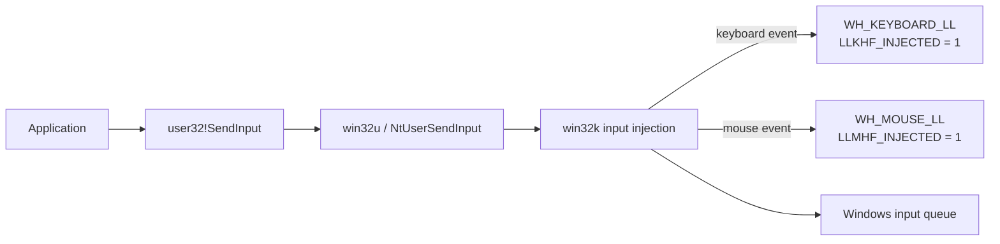
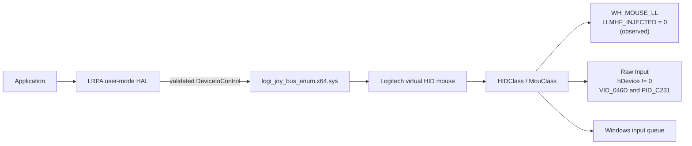

# Logitech Raw Peripheral Access (LRPA)

LRPA is a small, unofficial user-mode hardware abstraction layer (HAL) and SDK that sends relative mouse reports through Logitech G HUB's virtual HID bus without setting `LLMHF_INJECTED` on the tested stack, while returning substantially faster than `SendInput` in local benchmarks.

It provides .NET, C, C++, and Rust interfaces, plus a separate fail-closed module that recovers the private IOCTL family from the installed driver.

> LRPA is independent research software. It is not produced, endorsed, or supported by Logitech.

## Requirements

- Windows x64
- .NET 10
- Logitech G HUB and `logi_joy_bus_enum.x64.sys`

## Observed input paths

### Conventional `SendInput`



### LRPA virtual-HID path



LRPA does not call `user32!SendInput`. On the tested Windows and Logitech driver versions, its event entered through the virtual HID device and the low-level mouse hook received `flags == 0`. That is an observed compatibility result, not a Windows API guarantee. Raw Input still identifies the Logitech virtual device, so a clear hook flag is not proof of physical origin and must not be treated as a security boundary.

LRPA currently implements mouse reports only. It makes no claim about `LLKHF_INJECTED` for an LRPA keyboard path.

## Performance versus `SendInput`

A controlled local test alternated relative mouse moves through both paths after LRPA initialization. A dedicated `WH_MOUSE_LL` thread timestamped hook delivery. Each path had 25 warmups and 500 measured operations.

| Path | Call-return median | Start-to-hook median | Start-to-hook p95 | Hook classification |
|---|---:|---:|---:|---|
| `user32!SendInput` | 457.9 us | 129.3 us | 260.6 us | `LLMHF_INJECTED` set |
| `LrpaController.Move` | 8.3 us | 93.7 us | 290.4 us | `LLMHF_INJECTED` clear |

LRPA returned to its caller about **55x sooner** in this run, but that is not a 55x end-to-end latency improvement. Mean start-to-hook latency was effectively equal (`140.6 us` for `SendInput`, `140.7 us` for LRPA); LRPA had the lower median while `SendInput` had the lower p95. The result primarily reflects different completion semantics: the `SendInput` hook callback occurred a median `328.7 us` before the call returned, while LRPA returned a median `85.7 us` before its virtual-HID event reached the hook.

These figures characterize one machine and installed hook/driver stack. They do not measure USB polling or application consumption and should be repeated on any target configuration where latency matters.

## Build

```powershell
dotnet build .\LRPA.slnx -c Release
dotnet run --project .\src\LRPA.Cli -- self-test
```

Build the self-contained native x64 DLL:

```powershell
dotnet publish .\src\LRPA.Native -c Release -r win-x64 -o .\artifacts\native\win-x64
```

## SendInput migration

```csharp
using Logitech.RawPeripheralAccess;

INPUT[] inputs =
[
    LRPA.MouseInput(64, -16, LRPA.MOUSEEVENTF_MOVE)
];

try
{
    uint sent = LRPA.SendInput((uint)inputs.Length, inputs, INPUT.Size);
}
finally
{
    LRPA.Shutdown();
}
```

The familiar `INPUT`, `INPUTUNION`, `MOUSEINPUT`, and mouse-event constants are included. Relative movement, buttons, vertical wheel, and horizontal wheel are supported. Keyboard and absolute mouse input are intentionally rejected.

## Typed API

```csharp
using Logitech.RawPeripheralAccess;

using var mouse = new LrpaController();
mouse.TryCreateMouse();
mouse.Move(40, -10);
mouse.Click(MouseButtons.Button1);
mouse.Wheel(vertical: 1);
```

## Protocol recovery

IOCTL values are not runtime constants. `LRPA.ProtocolDiscovery` scans the installed PE once, validates the dispatch shape, HID report descriptor, virtual-device identity, and IOCTL encoding, then caches the immutable result.

Unsupported or ambiguous driver images fail before the bus receives an IOCTL. Fingerprinting is version-adaptive, not a guarantee that every future driver rewrite will remain compatible.

The report-submission path performs no scanning, reuses one bus handle, uses stack buffers, and has no third-party dependencies, reflection, middleware, or service framework.

## Native FFI

`LRPA.Native.dll` is a NativeAOT shared library with a stable C ABI. It does not require a separately installed .NET runtime.

```c
#include "lrpa.h"

lrpa_handle mouse;
lrpa_open(NULL, &mouse, NULL);
lrpa_move(mouse, 64, -16);
lrpa_close(mouse);
```

C++ can include `lrpa.hpp` for an RAII wrapper. The Rust binding provides a safe `Controller` whose `Drop` implementation closes the handle.

## Documentation

- [Integration guide](docs/INTEGRATION.md)
- [SDK/API reference](docs/API.md)
- [C/C++/Rust FFI guide](docs/FFI.md)
- [SendInput migration example](examples/SendInputMigration/Program.cs)
- [Typed controller example](examples/TypedController/Program.cs)
- [Read-only protocol inspection](examples/ProtocolInspection/Program.cs)
- [C example](examples/c/main.c)
- [C++ example](examples/cpp/main.cpp)
- [Rust example](examples/rust/src/main.rs)

## Provenance

On the tested G HUB driver `2026.0.0.0`, LRPA mouse reports appeared as Raw Input from virtual device `VID_046D&PID_C231`. The corresponding `WH_MOUSE_LL` event had `LLMHF_INJECTED` clear.

That flag does not establish physical origin. Raw Input still exposes the virtual device, and applications should not use a low-level-hook flag as their sole trust decision.

## Status

Experimental. Validated against one installed G HUB driver family. No package has been published.
